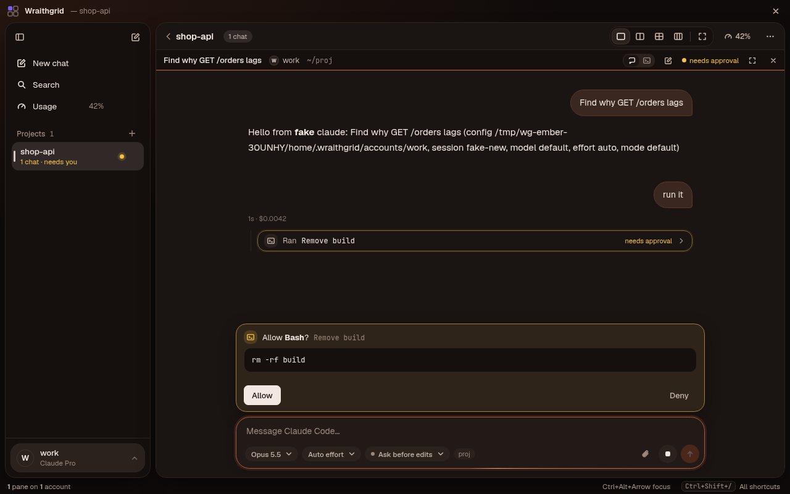

# Wraithgrid theme template

A starting point for a [Wraithgrid](https://github.com/cachewraith/wraithgrid) theme you can
share through the in-app **Community themes** gallery. This repo is also a theme itself: *Ember*.

## What a theme repo holds

| File | What it is |
|---|---|
| `wraithgrid-theme.json` | The theme: colors, plus an optional `style` (fonts, corners, depth, density, motion). Data only — the format is in Wraithgrid's [docs/THEMES.md](https://github.com/cachewraith/wraithgrid/blob/main/docs/THEMES.md). |
| `manifest.json` | `name`, `author`, `version` (`1.0.0`), `minAppVersion` (optional), `description`, `modes` (`["dark"]` or `["light"]`, matching the theme's `mode`). |
| `screenshot.png` | Shown in the gallery only. A PNG, 16:10 looks best, under 1.5 MB. |

One theme per repository. For a light and a dark version, publish two repositories.

## Make yours

1. **Use this template** (the green button) to create your own repository.
2. Design it in Wraithgrid: **Settings → Appearance → Customize…** edits any theme live over the
   whole app and warns when text gets hard to read. **Export…** saves the file; replace
   `wraithgrid-theme.json` with it.
3. Edit `manifest.json`: your theme's name, you as author, `version` `1.0.0`, a one-line
   description, and `modes`.
4. Take a screenshot of Wraithgrid with your theme on, save it as `screenshot.png`.
5. Try the published repo: **Settings → Appearance → Browse community… → Install from GitHub**
   with your repository's address.

## Get it listed

Open a pull request on [cachewraith/wraithgrid-themes](https://github.com/cachewraith/wraithgrid-themes)
adding your repository to `community-themes.json`. To ship an update later, raise `version`
in `manifest.json`: people who installed it see **Update** in the gallery.

## Rules

- No CSS, scripts, fonts or images go into the app: Wraithgrid reads only the JSON, checks every
  value against its schema, and installs nothing if a value is wrong (it says which).
- Keep text readable: aim for WCAG AA (4.5 : 1 for text). The editor checks it for you.

MIT licensed — use it as you like.
